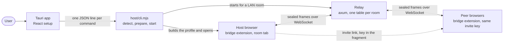

# Brosr

[](https://github.com/emrisca/brosr/actions/workflows/brosr-check.yml)
[](https://github.com/emrisca/brosr/actions/workflows/core-tests.yml)
[](https://github.com/emrisca/brosr/actions/workflows/lint.yml)

Brosr is a room of people in one browser page. Each person's cursor, scroll, navigation and
media controls show up in every other window. Brosr sends no video. A room costs about
10 KB/s per peer. A screen share needs 2 Mbps on a bad link.

A room starts in a browser Brosr picks and runs with its own profile, plus a bridge extension, a
room window and a relay. Firefox keeps full uBlock Origin, which is a Manifest V2 add-on. Brave
runs the Chromium lane with uBlock Origin Lite and P-Stream, loaded as unpacked packs. Google
Chrome refuses the flag that loads a local add-on from version 137, so Chrome appears in the
list with that reason.

Status: `v0.3.18` ships a signed macOS and Windows app. Rooms run in Firefox and Brave.

## Quick start for non-developers

You do not need Node, Rust or a checkout to try Brosr. Take the build for your machine from
[the latest release](https://github.com/emrisca/brosr/releases/latest):

| Machine | File |
| --- | --- |
| macOS on Apple silicon | [`Brosr_0.3.18_aarch64.dmg`](https://github.com/emrisca/brosr/releases/download/v0.3.18/Brosr_0.3.18_aarch64.dmg) |
| macOS on Intel | [`Brosr_0.3.18_x64.dmg`](https://github.com/emrisca/brosr/releases/download/v0.3.18/Brosr_0.3.18_x64.dmg) |
| Windows, 64-bit | [`Brosr_0.3.18_x64-setup.exe`](https://github.com/emrisca/brosr/releases/download/v0.3.18/Brosr_0.3.18_x64-setup.exe) or [`Brosr_0.3.18_x64_en-US.msi`](https://github.com/emrisca/brosr/releases/download/v0.3.18/Brosr_0.3.18_x64_en-US.msi) |

The macOS build carries an ad hoc signature and no notarisation, so the first launch needs one
extra step. Move Brosr to Applications, try to open it, then allow it in System Settings,
Privacy and Security, Open Anyway. On Windows, SmartScreen says "Windows protected your PC", so
click More info, then Run anyway.

There is no Linux build yet, and no `.AppImage` to download. The release workflow builds macOS
and Windows only.

## How a room fits together



The app never draws the room. It asks `host/cli.mjs` to build a room profile, start the relay
and open the host browser, then it reads and changes room settings through the panel command.
Every browser in the room holds one WebSocket to the relay. Frames are sealed with the key from
the invite fragment, so the relay forwards bytes it cannot read.

## What the repository holds

| Path | Contents |
| --- | --- |
| `docs/` | The design, split by subject. [docs/README.md](docs/README.md) is the index. |
| `core/` | The shared room code: protocol, clock, drift policy, media adapter, cursor overlay, input guards and the client. It holds no socket and no browser API. |
| `bridge/` | The room extension: background script, content script and room panel. `zen/package.mjs` builds the Firefox XPI and the Chromium folder. |
| `host/` | The room lifecycle: detect a browser, build a profile, run the relay, open the browser, and answer one JSON line per command. |
| `app/` | The Brosr app. A Tauri window with a React setup flow that drives `host/cli.mjs`. |
| `spike/` | The M0 harness and the M1, M3 and M4 checks. It downloads its own Firefox. |
| `zen/` | The older Zen lane: profile setup, the live window and the legacy docked panel. |
| `relay/` | The axum relay. It forwards frames per room and serves the fixtures. |
| `docs/m0-results.md` | What the M0 spike measured. |
| `assets/` | The Brosr app icon. `brosr-icon.svg` is the source, and `node assets/render-icon.mjs` draws the 1024 pixel `brosr-icon.png` from it. The 16 to 256 pixel copies feed the extension manifest and the app surfaces only. `node assets/icons.mjs` rebuilds the copies and `brosr.ico`. `assets/windows-shortcut.ps1` writes a Windows shortcut and tile from that ICO. |

## Check the core

`core/` has no dependencies. It runs in Node and in a content script.

```bash
cd core
npm test
```

The suite covers protocol encode and decode, the clock estimator, the drift controller, the
overlay, the room state and the input guards.

The host lifecycle has its own suite, and the two run in one pass from the repo root:

```bash
node --test core/test/*.test.mjs host/test/*.test.mjs
```

## Check the landing links

The Watch directory in `landing/index.html` mirrors the starred FMHY sites in Stream
Aggregators and Anime Streaming. P-Stream forks sit in Stream Aggregators, so the
check compares them with that group. The check fetches the current FMHY source and
compares every name and URL:

```bash
node scripts/check-fmhy-links.mjs
```

It prints the count for each group and exits nonzero when a link is missing, extra or
changed. Point it at a saved copy with `--source=.runtime/fmhy-video.md`. The check also
runs every Monday from `.github/workflows/fmhy-links.yml`.

## Run a room

The Brosr app sets up a room and opens it. It is a Tauri window with a React interface, and
it calls `host/cli.mjs` for every step.

```bash
cd app
npm install
npm run tauri dev
```

The app finds the Firefox and Chromium builds on the machine. Pick one. The app builds a separate room
profile, installs the blockers and the bridge, then starts the relay and opens the browser
on the room. The panel is the extension's own popup, so it draws inside the browser window
and never in one of its own. The toolbar icon and the room shortcut open it.

### Panel check, 14 November 2026

Both lanes passed on this machine. The Chromium lane ran on Brave, because Chrome 137 and later
refuse `--load-extension`.

| Build | Result |
| --- | --- |
| Brave 156.1.98.63 | The lane loaded the unpacked build and read a live dataset with `socket: 1` from the room page. The relay counted one peer. |
| Zen 1.24.1b | The lane installed the XPI and read a live dataset, then read the panel in a tab. The panel reported `live`, a 14.13 contrast, the invite link and the grant history. |

The toolbar opens the panel as an anchored popup in both engines, declared as `default_popup` in
the Gecko manifest and in the Chromium one. The panel page names its surface in the URL, so one
stylesheet sizes the popup and fills a tab. No code opens a window outside the browser. A popup
needs a click, so the host and the app name the toolbar icon and the chord instead of offering a
button.

The Chromium lane needs no extra package, because Node ships a WebSocket client:

```bash
node zen/check-chrome.mjs
```

A host alone on 14 November 2026 read `0` in the header and `Brosr room · 0` in the title. It
also read `No peers in this room yet.` in the list.

The host answers one JSON line per command, so the same steps run without the app:

```bash
node host/cli.mjs detect
node host/cli.mjs start --browser=zen --name=Host
node host/cli.mjs status
node host/cli.mjs stop
```

`zen/live.mjs` is the older Zen lane. It builds the same profile, opens Zen on a room and
docks the legacy panel:

```bash
node zen/live.mjs --room=demo
```

It leaves the browser and the relay running and writes `zen/.runtime/live.json`.
`--bridge=built` runs the unsigned build in `zen/.runtime/bridge.xpi`, and `--no-configure`
skips the add-on pass on a throwaway profile. `zen/README.md` has the detail.

## Make a release

The app updates from GitHub releases. A tag starts the workflow, and the workflow
builds the macOS app with the signed updater files.

1. Bump the version in every manifest and commit it:

   ```bash
   node app/scripts/release.mjs <version>
   ```

   The script writes `app/package.json`, `app/package-lock.json`,
   `app/src-tauri/tauri.conf.json`, `Cargo.toml` and `Cargo.lock`, then prints the tag
   commands.
2. Tag and push the version it printed:

   ```bash
   git tag v<version>
   git push origin v<version>
   ```

3. Wait for the `release` workflow. It creates the release and attaches the app, the
   disk image and `latest.json`.

The app reads `releases/latest/download/latest.json` on start and every six hours
after that. A newer version opens the update popup. The install runs in place and
restarts the app.

The signing key pair lives in `.secrets/brosr-updater.key`, which git ignores. The
repository secret `TAURI_SIGNING_PRIVATE_KEY` holds the same key. The key has no
password, so the password input stays empty. Back the key up. A lost key means an
installed app cannot accept the next release.

## Run the spike

The harness needs Node and ffmpeg. It downloads Firefox Nightly and uBlock Origin into
`spike/.runtime/`, encodes a 120 second test clip, starts a relay on `127.0.0.1:8787` and
writes `spike/results.json`.

```bash
cd spike
node run.mjs
```

`--only=ad,bidi,media,room` runs a subset of the checks. `--soak=3600` runs the one hour
reconnect soak. A full run takes about four minutes. The download in `run.mjs` is a Windows
build, so macOS passes a binary instead with `--firefox=<path>`.

The `.runtime` directory stays out of git, because a run rebuilds it.

## What a room cannot do

| Case | Why |
| --- | --- |
| Netflix, Disney+ and Prime Video | The DRM layer controls the media pipeline, so a script cannot set the playhead. |
| Identical pixels | Each person renders the page on their own machine, so a different window size gives a different layout. |
| One shared login | Each person signs in on their own copy. Cookies never cross the relay. |
| Trusted input in v1 | v1 relays synthetic events. Typing into a native control needs the Firefox remote agent, which is M7. |

## Contributing

[CONTRIBUTING.md](CONTRIBUTING.md) covers the dev setup, the spike, the good first issues and
what a pull request needs. [CODE_OF_CONDUCT.md](CODE_OF_CONDUCT.md) sets the tone for issues
and reviews.

## Where to read the detail

- [docs/README.md](docs/README.md) indexes the design, one file per subject.
- [docs/design.md](docs/design.md) states what works per use case and what a room cannot do.
- [docs/sync.md](docs/sync.md) covers the layers, the protocol and the media policy.
- [docs/milestones.md](docs/milestones.md) tracks M0 to M8 with the as-built notes.
- [core/README.md](core/README.md) explains the modules and the five rules the code depends on.
- [spike/README.md](spike/README.md) records the last run and the findings that changed the code.
- [docs/m0-results.md](docs/m0-results.md) summarises the M0 measurements.
