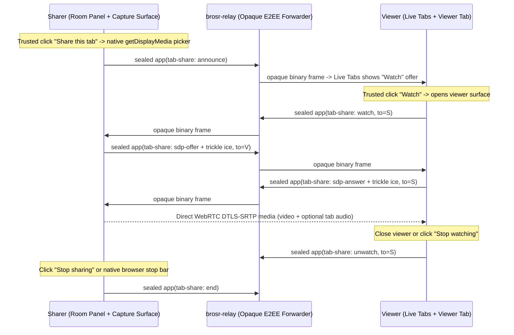

# Single-tab screen-share plan

Part of the [Brosr design index](README.md).

**Status:** Design plan (not yet implemented).

## Why this exists

Brosr's default path syncs state rather than pixels: each person loads their own copy of a page,
and a room costs about 10 KB/s per peer. That stays the default.

Some pages cannot be synced that way:

- **DRM-locked players** (Netflix, Disney+, Prime Video) where Encrypted Media Extensions block
  script playhead control.
- **Per-user or private web apps** (local dev servers, authenticated dashboards, documents or
  design tools that another peer does not have an account for).
- **Non-deterministic or local-state pages** (custom WebGL/canvas views, interactive charts,
  local PDFs, or pages behind a POST/redirect flow that a shared URL cannot reproduce).

When state sync is impossible, any person in the room should still be able to show **one tab**
cleanly without leaving Brosr, without forcing anyone else to open it, and without turning
`brosr-relay` into a video server.

## Design principles

Every part of this plan stays inside Brosr's existing architecture and the six guardrails in
`AGENTS.md`:

1. **Low-bandwidth sync remains the default.** Video streams only when someone explicitly clicks
   **Share this tab** and another person clicks **Watch**. Idle peers receive zero video bytes.
2. **Available to every room member.** Showing your own tab is passive viewing, not remote
   control. Any peer (host or guest, with or without an input grant) can offer a single-tab share
   from the room panel.
3. **Opt-in offers in Live Tabs (Layer 1).** A tab share appears as an offer under the sharer's
   name in `#live-tabs`, never as a forced popup or auto-playing overlay. Viewers join by
   clicking **Watch** and leave by closing the viewer or clicking **Stop watching**.
4. **End-to-end sealed signaling, peer-to-peer media.** Signaling reuses existing sealed `/room`
   `app` frames (`core/protocol.mjs` + `core/seal.mjs`). Media travels peer-to-peer over WebRTC
   DTLS-SRTP; video bytes never cross `brosr-relay`.
5. **Explicit consent and visible kill switch.** Capture requires a trusted user click, uses the
   browser's native single-tab picker and persistent sharing indicator, and stops immediately on
   **Stop sharing**, tab close, or room leave.
6. **Guardrails #1–#6 from day one.** One strict schema (`core/tab-share.mjs`), local UI drawn
   before remote I/O, one owner per `shareId`, capability flag in `hello`, `{ allow, reason }`
   policy decisions, and boundary tests before landing.

## Preferred design: "Share this tab" in the room panel

### 1. Room panel entry point (for every user)

Add a **Share this tab** control in the `Room` pane of `bridge/panel/room.html` and
`bridge/panel/room.js` (accessible from the toolbar popup or room shortcut for both host and
guests):

- **Idle state:** Shows a compact card (`Tab share`) with:
  - Primary button: **Share this tab** (requires a trusted click).
  - Optional checkbox: **Include tab audio** (default on for media tabs, off otherwise).
  - One-line privacy note: *"Shows only the one tab you pick. Viewers opt in from Live tabs."*
- **Active state:** Shows a high-contrast `Sharing` badge, the shared tab title, active viewer
  count (`2 watching`), current send resolution/bitrate, and a prominent **Stop sharing** button.
- **Capture host surface (Gecko + Chromium parity):**
  - Because an extension toolbar popup closes as soon as the native browser picker takes focus,
    clicking **Share this tab** hands off from the popup to a lightweight, dedicated extension
    capture surface (or the room tab itself) carrying the user gesture to call
    `navigator.mediaDevices.getDisplayMedia(...)`:
    ```js
    navigator.mediaDevices.getDisplayMedia({
      video: {
        displaySurface: 'browser',
        frameRate: { ideal: 30, max: 30 },
        width: { ideal: 1920, max: 1920 },
        height: { ideal: 1080, max: 1080 },
      },
      audio: includeAudio,
      preferCurrentTab: false,
      selfBrowserSurface: 'exclude',
      systemAudio: 'exclude',
    });
    ```
  - On Chromium MV3 (`bridge/manifest.chrome.json`), the background service worker cannot hold
    `MediaStream` or `RTCPeerConnection`. Hosting the capture stream and `RTCPeerConnection`
    instances inside the room tab (or a dedicated pinned extension tab such as
    `panel/share.html`) keeps **Firefox/Zen (MV2)** and **Brave/Chromium (MV3)** on one shared
    code path and guarantees that closing the room ends capture immediately.
  - Listen for `videoTrack.addEventListener('ended', stopShare)` so clicking the browser's own
    native "Stop sharing" bar cleans up the Live Tabs offer and all peer connections at once.

### 2. Opt-in viewer offer in Live Tabs

Live Tabs (`#live-tabs` in `landing/index.html`, state in `core/live-tabs.mjs`) remains the
single source of truth for everything offered in the room:

- Active tab shares appear under the sharer's group (even if the sharer is an ungranted guest,
  giving them a group badged `Sharing`) alongside any normal offered tabs.
- Each share row displays:
  - Distinct badge: `Live tab` (plus `Audio` if tab audio is included, and viewer count).
  - The shared tab's clean title (never raw credentials or query secrets).
  - For other peers: **Watch** (trusted click) when not watching; **Watching** + **Focus** +
    **Stop watching** when already attached.
  - For the sharer: **Stop sharing** directly from either Live Tabs or the room panel.
- Clicking **Watch** opens a clean local viewer surface — either a lightweight room viewer route
  (`/watch/#<shareId>` served alongside `/canvas`, `/notes`, `/chess`) or an expandable inline
  player card on the landing page — with mute, volume, fullscreen, and Picture-in-Picture
  controls.
- Closing the viewer tab or clicking **Stop watching** sends an `unwatch` signal and closes that
  viewer's `RTCPeerConnection` without affecting anyone else.

### 3. E2EE signaling over existing `/room` `app` frames

No changes are required in `relay/src/main.rs` or `spike/relay.js`. Signaling rides over the
existing `type: 'app'` message envelope in `core/protocol.mjs` under a dedicated namespace:

```js
export const TAB_SHARE_APP = 'tab-share';
```

Because `core/browser-entry.mjs` seals every outgoing WebSocket frame with XChaCha20-Poly1305
under the HKDF-SHA256 room key derived from `#k=` (`core/seal.mjs`, AAD `brosr/v1/<room>`):

- **What stays hidden from the relay:** Shared tab titles, audio flags, WebRTC SDP offers and
  answers, DTLS certificate fingerprints, and ICE host/srflx candidates (including local LAN and
  Tailscale IP addresses). The relay continues forwarding opaque binary (opcode 2) frames.
- **16 KB frame budget (`MAX_FRAME_BYTES = 16 * 1024`):**
  - Typical WebRTC SDP payloads are 3–6 KB, comfortably below the 16 KB ceiling.
  - Use **trickle ICE** so each ICE candidate travels in a small ~200-byte frame instead of
    inflating the initial SDP.
  - `core/tab-share.mjs` validates every field strictly (Guardrail #1: unknown fields rejected)
    and trims unnecessary SDP extensions or refuses malformed payloads over the ceiling rather
    than fragmenting blindly.
- **Capability negotiation (Guardrail #4):** Add an optional `tabShare: true` capability flag to
  `hello` / `welcome` so older bridge builds are detected cleanly instead of receiving
  unsupported signaling frames.

#### Signaling messages (`type: 'app'`, `name: 'tab-share'`)

| `action` | Sender -> Target | Fields | Purpose |
| --- | --- | --- | --- |
| `announce` | Sharer -> room (`to: '*'`) | `shareId`, `title`, `audio`, `maxViewers`, `rev` | Publishes or updates the Live Tabs offer |
| `end` | Sharer -> room (`to: '*'`) | `shareId`, `reason` | Removes the offer and closes all viewer sessions |
| `watch` | Viewer -> Sharer (`to: sharerId`) | `shareId` | Opt-in request to start a WebRTC session |
| `unwatch` | Viewer -> Sharer (`to: sharerId`) | `shareId` | Viewer closed or clicked Stop watching |
| `sdp-offer` | Sharer -> Viewer (`to: viewerId`) | `shareId`, `sdp`, `rev` | WebRTC offer created after accepting `watch` |
| `sdp-answer` | Viewer -> Sharer (`to: sharerId`) | `shareId`, `sdp`, `rev` | Viewer's WebRTC answer |
| `ice` | Either -> Peer (`to: peerId`) | `shareId`, `candidate` | Trickle ICE candidate (sealed inside `/room`) |

Every targeted message carries `to: <peerId>`. Receivers drop messages addressed to another peer
before touching WebRTC state, and ignore `watch` / `sdp-answer` / `ice` for unknown `shareId`s.



### 4. WebRTC media transport

- **Topology:** Direct **1-to-N peer mesh** from the sharer to opted-in viewers only. Brosr rooms
  are small (typically 2–6 people), so a direct mesh avoids any server infrastructure while
  keeping latency minimal.
- **Encryption:** WebRTC enforces **DTLS-SRTP** on every media packet. Because the SDP DTLS
  fingerprints are exchanged inside Brosr's XChaCha20-Poly1305 sealed `/room` channel, an
  untrusted relay or network observer cannot MITM the media keys.
- **ICE / NAT traversal:**
  - **LAN and Tailscale rooms (primary Brosr path):** Host/local ICE candidates connect directly
    with zero external servers and no IP leak to third-party STUN hosts. Default `iceServers: []`
    on loopback/LAN/tailnet rooms unless WAN mode is explicitly enabled.
  - **Internet / WAN rooms:** Optional user-configurable STUN/TURN list (for example, a
    self-hosted `coturn` alongside a hosted `brosr-relay`), exposed clearly in room config so
    no third-party STUN server is contacted silently.
- **Adaptive bitrate & resource caps:**
  - Hard viewer cap per share (default `MAX_SHARE_VIEWERS = 4`, configurable) so one sharer's
    uplink is never saturated by accident.
  - Per-sender `RTCRtpEncodingParameters.maxBitrate` scales with viewer count:
    - 1 viewer: up to ~2.5 Mbps (1080p @ 30 fps)
    - 2 viewers: up to ~1.8 Mbps each (720p–1080p @ 30 fps)
    - 3–4 viewers: up to ~1.2 Mbps each (720p @ 30 fps)
  - Optional Opus tab audio at 64–96 kbps (`echoCancellation: false`, `noiseSuppression: false`,
    `autoGainControl: false` on captured tab audio so music/film audio is not degraded).
  - Content hint: set `videoTrack.contentHint = 'motion'` for video tabs or `'detail'` for
    document/code tabs (user-selectable or inferred) so the encoder prioritizes smoothness or
    text sharpness appropriately.
- **Honest DRM note:** Widevine/EME hardware-protected streams may appear black in
  `getDisplayMedia` capture depending on OS/browser DRM policy. Brosr should state this plainly
  in the UI rather than attempting workarounds.

### 5. Security and privacy guardrails

Every decision in `core/tab-share.mjs` follows **Guardrail #5** by returning
`{ allow, reason, message }`:

| Guardrail | Rule | Refusal `reason` |
| --- | --- | --- |
| **Sealed room required** | Refuse starting or signaling a tab share when the room has no `#k=` `sealKey` (ICE candidates reveal IP addresses; SDP must stay authenticated). Local fixture tests may pass an explicit opt-in flag. | `unsealed-room` |
| **Trusted user gesture only** | Capture starts only from a trusted click (`event.isTrusted`) in the room panel; remote peers can never trigger capture or select a tab. | `untrusted-gesture` |
| **Single-tab picker & visibility** | Request `displaySurface: 'browser'` + `selfBrowserSurface: 'exclude'`. Keep the browser's persistent capture indicator and a visible red `Sharing` badge + **Stop sharing** button in the panel. | `capture-denied` |
| **Sensitive origin check** | Refuse offering a share when the active tab's URL is non-HTTP/HTTPS (`chrome:`, `about:`, `file:`, `moz-extension:`) or matches the blocked banking/payment origins in `core/input.mjs` (when URL metadata is known). | `blocked-origin` |
| **Single owner & room caps** | At most 1 active share per peer (`MAX_SHARES_PER_PEER = 1`), 2 concurrent shares per room (`MAX_ROOM_SHARES = 2`), and `MAX_SHARE_VIEWERS = 4` viewers per share. Only `ownerId === sender` can update or end a share. | `share-limit`, `too-many-viewers`, `not-owner` |
| **View-only by default** | Shared tab streams never accept relayed clicks, keys, text, or scroll. Existing `core/input.mjs` and `core/trust.mjs` guards remain untouched. | `view-only-stream` |
| **Signaling rate limits** | Cap `announce`/`watch`/`sdp-*`/`ice` messages per peer per second inside `core/sync.mjs` alongside existing input and align rate limits so a rogue peer cannot flood WebRTC state. | `rate-limited` |
| **Zero relay media load** | Reject any attempt to send raw video/image frames through `/room` WebSocket messages; only small signaling payloads under `MAX_FRAME_BYTES` are accepted. | `frame-too-large` |
| **Clean teardown** | Stopping the share, closing the captured tab, leaving the room, revoking connectivity, or closing the browser immediately stops all `MediaStreamTrack`s, closes all `RTCPeerConnection`s, and broadcasts `end`. | `ended` |

## Alternatives considered

| Option | UX & Discovery | Browser support (Gecko + Chromium) | Bandwidth & Latency | Relay load | E2EE & Privacy | Verdict |
| --- | --- | --- | --- | --- | --- | --- |
| **1. Room panel "Share this tab" + `getDisplayMedia` + WebRTC over E2EE `/room` `app` frames** | Clean one-click start in room panel; opt-in **Watch** row in Live Tabs; native browser stop indicator | **Full parity** on Firefox 140+/Zen and Brave/Edge/Chrome | Low latency (<100 ms LAN/Tailscale); adaptive 1.2–2.5 Mbps per active viewer only | **Zero media load** (~few KB signaling only) | Signaling sealed with XChaCha20-Poly1305; media encrypted with DTLS-SRTP; zero third-party vendor | **Recommended** |
| **2. Chromium `chrome.tabCapture` + MV3 Offscreen Doc + WebRTC** | Skips OS/browser picker on Chromium (captures active tab directly) | **Chromium only** — Firefox/Zen does not implement `chrome.tabCapture` | Same as Option 1 | Zero media load | Requires extra `tabCapture` + `offscreen` permissions and loses native browser picker consent | **Not baseline** (possible future Chromium-only shortcut behind the same `core/tab-share.mjs` protocol) |
| **3. Relay-forwarded JPEG/WebP canvas snapshots over `/room` WebSocket** | No WebRTC/ICE setup needed; works across any NAT | Full parity | High bandwidth for poor quality (2–5 fps, no audio, choppy playback) | **Severe** — violates 16 KB frame ceiling and destroys ~10 KB/s relay budget | Sealed via `sealFrame()`, but saturates relay memory/CPU | **Rejected** |
| **4. Hosted SFU (LiveKit / mediasoup / Cloudflare Calls)** | Scales to 10+ viewers without heavy sharer uplink | Full parity | Low latency; single uplink from sharer | Offloads `brosr-relay` to a second server | Adds external vendor or second deployment; true E2EE requires Insertable Streams/SFrame key management | **Rejected for v1** (overkill for 2–6 person rooms; revisit only if large rooms become a goal) |
| **5. External screen-share link (Discord / Jitsi / OS share)** | Breaks room flow; requires a second app/account and manual links | Depends on third-party app | Varies | Zero | Third-party servers see metadata or media; loses Live Tabs opt-in UX | **Rejected** (already what users do without Brosr) |

## Phased implementation plan

1. **Phase 1 — Pure core protocol & policy (`core/tab-share.mjs` + `core/test/tab-share.test.mjs`):**
   - Define `TAB_SHARE_APP = 'tab-share'`, strict payload validators (Guardrail #1), share state
     table, viewer cap logic, and `tabShareDecision(...)` (Guardrail #5).
   - Add per-peer signaling rate limit in `core/sync.mjs` and `tabShare` capability flag in
     `core/protocol.mjs` `hello`/`welcome`.
   - Ship failing-first unit tests for every refusal reason (`unsealed-room`, `not-owner`,
     `too-many-viewers`, `share-limit`, `blocked-origin`, `rate-limited`, `frame-too-large`).
2. **Phase 2 — Capture surface, panel button & Live Tabs viewer:**
   - Add the **Share this tab** card to `bridge/panel/room.html` / `room.js` (for every user, host
     and guest).
   - Wire WebRTC sender/receiver orchestration in `core/browser-entry.mjs` (or a dedicated
     `landing/watch/` viewer page + capture helper tab) with `RTCPeerConnection` cleanup on
     `ended`, `unwatch`, `end`, and `bye`.
   - Render opt-in `Live tab` share rows in `#live-tabs` (`landing/index.html`) with **Watch** /
     **Stop watching** and **Stop sharing** actions guarded by `event.isTrusted`.
3. **Phase 3 — Cross-engine verification & docs update:**
   - Verify Firefox/Zen <-> Brave WebRTC tab share over loopback and Tailscale with
     `RELAY_CAPTURE` confirming zero plaintext SDP/ICE leakage and zero video frames on the relay.
   - Verify capture teardown when the shared tab closes, when the sharer clicks the browser's
     native Stop bar, and when a viewer closes its tab.
   - Update `docs/privacy.md`, `docs/sync.md`, and `docs/regressions.md` once shipped.
